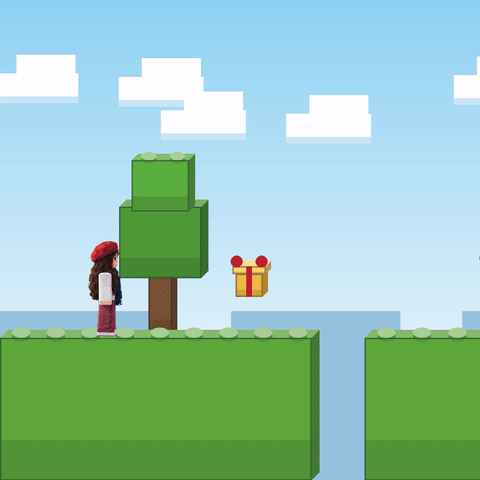
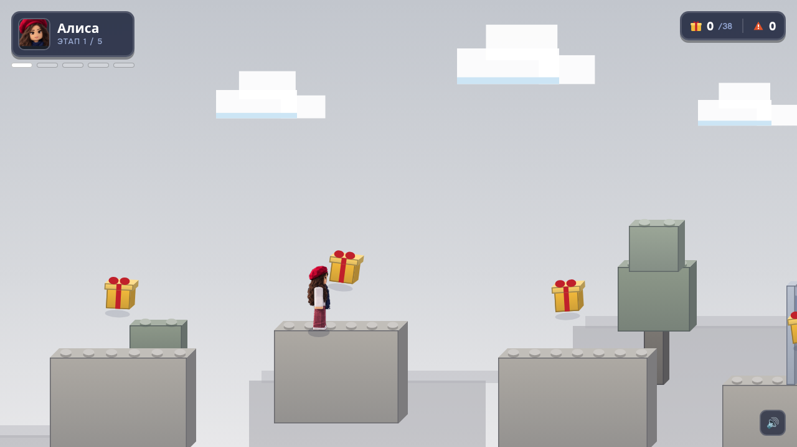
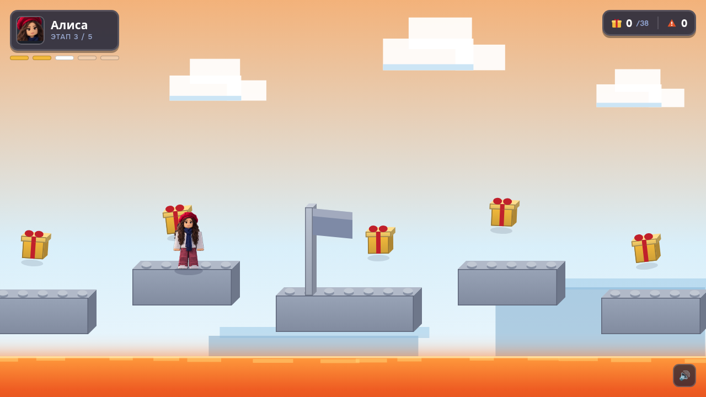
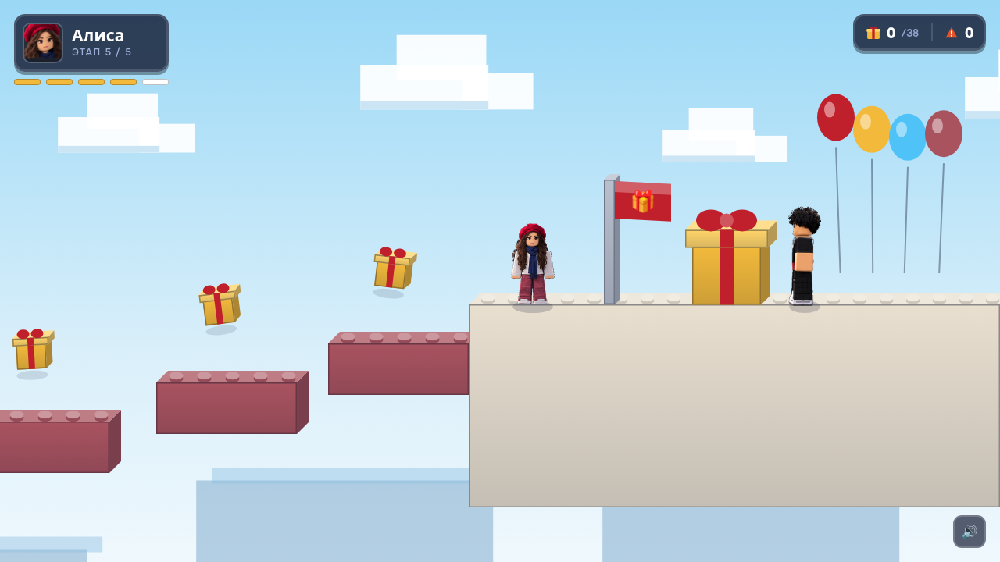
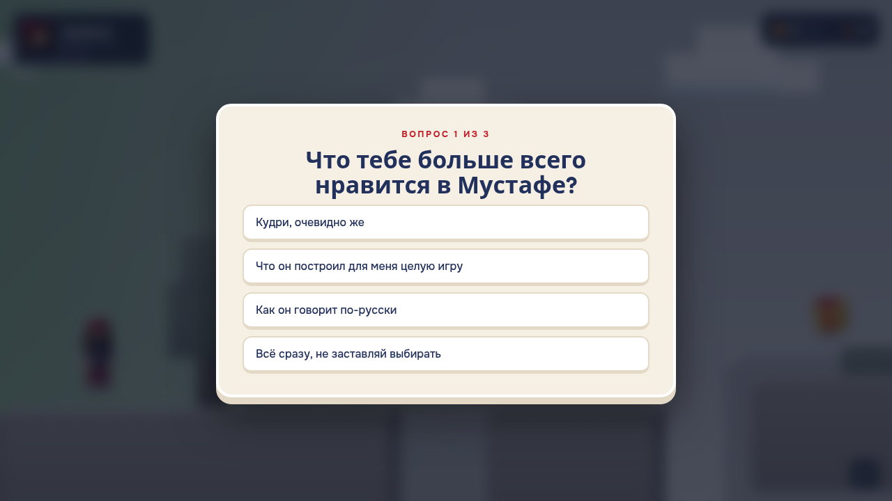

# Обби Алисы — a Roblox-style birthday obby

A five-stage platformer built as a birthday gift, rendered entirely in a single
HTML file with **no engine, no framework and no dependencies** — one `<canvas>`,
one build script, and a procedural chiptune soundtrack generated at runtime.



| | |
|---|---|
| **Stack** | Vanilla JS, Canvas 2D, Web Audio API |
| **Dependencies** | none |
| **Build** | one Python script, no toolchain |
| **Output** | a single self-contained `.html` that runs offline |

---

## What's interesting about it

### Everything is drawn, nothing is an asset

There are no sprite sheets for the world. Every platform, tree, gift and cake is
drawn as an extruded Roblox-style "part" — three shaded faces plus studs on top —
computed at runtime:

```js
function part(d, x, y, w, h, col, depth) {
  // right face, top face, front face, then studs along the top
}
```

The only bitmaps are the two character avatars, cut out of reference art with a
flood-fill background remover (`game/extract.py`) and embedded as base64.

### Procedural, adaptive music

No audio files. The soundtrack is generated live with Web Audio oscillators using
a lookahead scheduler, and it reacts to play:

- each stage has its own key and tempo (the lava stage drops to A minor at 128bpm)
- the arrangement thickens as the player advances — bass, then arpeggio, then
  melody and drums
- it ducks on death and under dialogue, and stops for the finale

### Fixed-timestep physics

Physics runs on a fixed 1/120s accumulator rather than raw frame delta, so jump
arcs are identical regardless of refresh rate or dropped frames. Includes coyote
time, jump buffering, variable jump height, and a double jump with a somersault.

### Camera dead zone

The camera only pans vertically when the player leaves a 374px band — wider than
a double jump (279px), so ordinary jumping never moves the view. An earlier
version smoothed toward the player every frame and read as input lag.

---

## Screenshots

| | |
|---|---|
|  |  |
|  |  |

The first stage is desaturated on purpose, with colour visible at both far ends
of the level and never reachable — the level *is* the metaphor it's named after.

---

## Build

```bash
python3 game/build.py
```

Reads `game/src/template.html`, inlines every sprite as a base64 data URI, and
writes a single `game/alisa_obby.html` that works from `file://` with no server
and no network.

```
game/
  src/template.html   source (all markup, CSS and JS)
  sprites/            extracted character art
  extract.py          cuts sprites out of reference images
  build.py            inlines assets -> one self-contained file
  serve.py            local preview server (UTF-8 headers)
story_video/
  make_story.py       renders an animated short with PIL + ffmpeg
```

## Testing

The game ships with a `TEST` flag in its config. While enabled it shortens
timers, shows an on-screen jump bar for skipping between stages, and displays a
permanent red badge so the build can never be shown in test mode by accident.

Level completability was verified by scripting a bot against the physics
directly — driving `step()` headlessly and asserting every stage completes
across repeated runs with randomised moving-platform phases. That caught a
collision bug where a moving platform's delta was applied twice, and a level
geometry error where a platform's travel drove it 35px inside a solid block.

## Notes

The personal video message and its build artifact are excluded from this
repository — see `.gitignore`. Run the build script to produce a playable file
without it; the video step is skipped automatically when no video is present.

---

## Play it

**[Play in the browser →](https://elkushi.github.io/alisa-obby/game/alisa_obby.html)**

This public build does **not** include the personal video message: `build.py`
skips that step when `game/video/` is empty, and the folder is gitignored. The
gift version, built with the video, stays offline.
